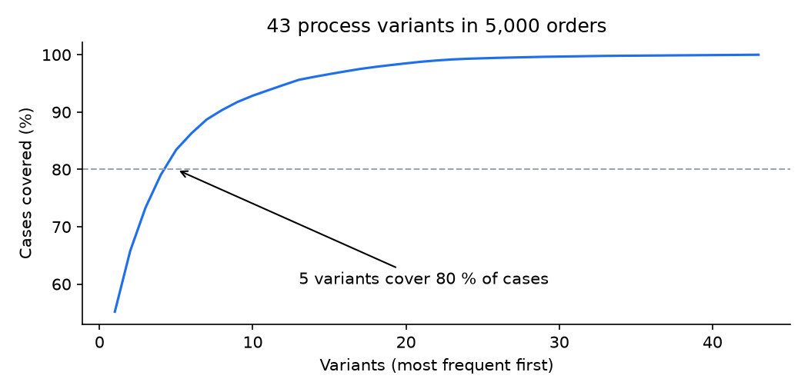
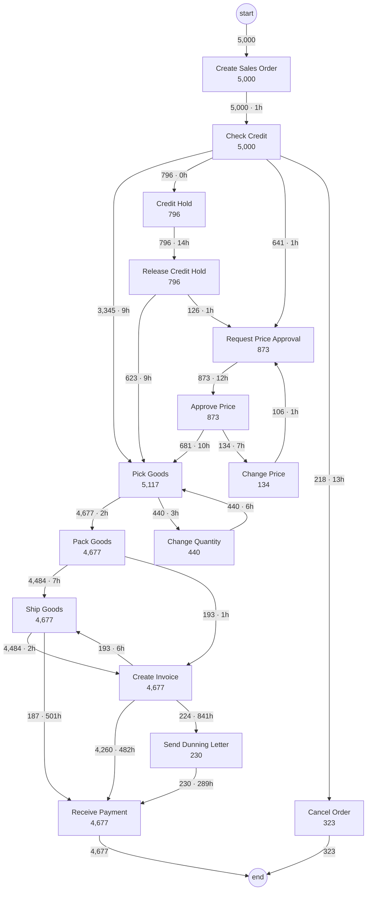
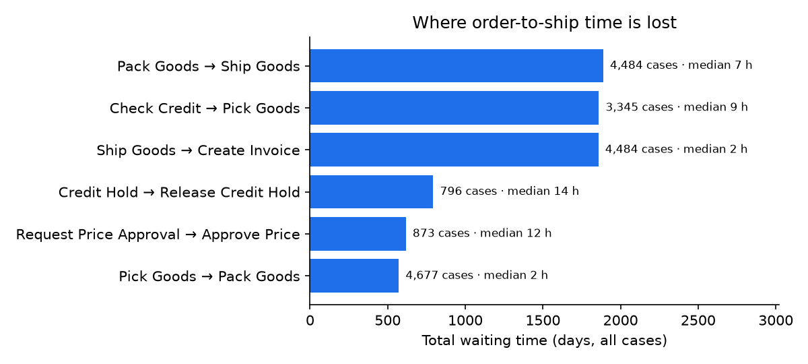
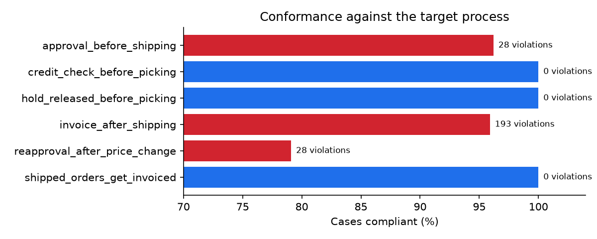

# Order-to-Cash Process Mining

Every ERP has an order-to-cash process "on paper". This project reconstructs the one that actually
happens, straight from the event log. It shows where the time goes, where the process breaks the
rules, and which automations would pay off first. The questions are the ones a Celonis or Signavio
project answers, built from scratch in Python so every number can be traced back to the code.

**Event log in (case_id, activity, timestamp, resource) → process map, variants, bottlenecks, root causes, conformance, sized automation backlog**

The log format is the standard one used by pm4py, Celonis and Disco, so an export from SAP, Dynamics,
Odoo, Zoho or Salesforce can be analysed the same way.

## Findings on 5,000 simulated orders (38,290 events)

The simulator (`scripts/generate_log.py`) builds in the problems a real O2C project usually finds:
credit holds, manual price approvals, rework loops, a slow manual billing queue and compliance
gaps. The analysis has to find them without being told where they are.

### 1. The process: 43 variants, 5 cover 80 % of orders

Only **55 %** of orders follow the happy path (order → credit check → pick → pack → ship → invoice → payment).
The rest go through credit holds (10 %), price approvals (9 %), quantity changes with re-picking (9 %) or cancellation.



<details><summary>Discovered process map (edges used by ≥ 2 % of orders, label = orders · median wait)</summary>



</details>

### 2. Bottlenecks: where order-to-ship time is lost

Median order-to-shipment lead time is **30.6 h**; the slowest 10 % take **67.7 h** or more.
Ranked by *total* waiting time (frequency × wait), not by the slowest single step:



* **Ship → Invoice** has a median of only 1.8 h but the third-largest total wait. 27 % of orders still go
  through a manual billing queue that takes about a day longer, and every hour there delays cash.
* **Credit hold → release**, root cause by region: median **33.5 h in Southern Europe** against
  11.9–14.1 h everywhere else. That is one team's queue, not a process-wide problem.
* **Price approval** waits a median of 11.9 h, and 2 % of orders need it twice because the price changed after approval.

### 3. Conformance against the target process

| Rule | Checked | Violations | Compliant |
|---|---|---|---|
| Discount > 15 % needs approval before shipping | 730 | 28 | 96.2 % |
| Credit checked before picking | 4,677 | 0 | 100 % |
| Credit hold released before picking | 746 | 0 | 100 % |
| Invoice only after shipping | 4,677 | 193 | 95.9 % |
| Price change after approval → new approval | 134 | 28 | **79.1 %** |
| Every shipped order is invoiced | 4,677 | 0 | 100 % |



The violating order numbers per rule are in `docs/conformance_violations.csv`, ready for an audit sample.

### 4. Automation backlog, sized

Only **6 %** of orders get through order administration without a manual touch. Four candidates, each with a rule
and the waiting time it removes:

| Candidate | Rule | Orders | Waiting removed |
|---|---|---|---|
| Invoice automatically at goods issue | trigger invoice on `Ship Goods` | 1,326 (27 %) | 1,554 days |
| Auto-approve small discounts | order < €5k and discount ≤ 20 % | 340 (7 %) | 243 days |
| Auto-release small credit holds | order < €2k, no overdue invoices | 213 (4 %) | 202 days |
| Automated credit check for SMB | credit API score, manual below threshold | 1,480 (30 %) | 159 days |

Automatic invoicing alone means invoices go out about a day earlier on a quarter of all orders, which directly lowers DSO.
The two approval rules remove the most *manual* work, and also close the re-approval compliance gap,
because a system cannot forget to re-approve.

## How it works

| Module | What it does |
|---|---|
| `eventlog.py` | Loads and validates the log, sorts by case and time, computes directly-follows pairs and waiting times |
| `discovery.py` | Directly-follows graph (frequency + median/total wait), variants with coverage, Mermaid process map with a frequency filter |
| `performance.py` | Order-to-ship lead time, bottlenecks ranked by total wait (payment terms excluded), rework detection, root-cause breakdown by any case attribute |
| `conformance.py` | Declarative rules (precedence, response, re-approval after change) checked on every case, with the list of violating cases |
| `automation.py` | Touchless rate on order administration; automation candidates with affected orders and waiting time removed |

Adding a business rule is a few lines:

```python
Rule("approval_before_shipping", "Orders with discount > 15 % need a price approval before shipping",
     applies=lambda trace, case: "Ship Goods" in trace and case["discount"] > 0.15,
     holds=precedence("Approve Price", "Ship Goods"))
```

## Run it

```bash
pip install -e ".[dev]"
python scripts/generate_log.py   # 5,000 orders -> data/events.csv + data/cases.csv
python scripts/analyse.py        # docs/results.json, process_map.md, violations, charts
pytest -q                        # 11 tests
```

To analyse your own export, give `EventLog.from_csv()` a CSV with `case_id, activity, timestamp, resource`
and optionally a case table with attributes (region, customer segment, order value …).

CI regenerates the log and re-runs the whole analysis on every push; the findings table is
in the run summary.
